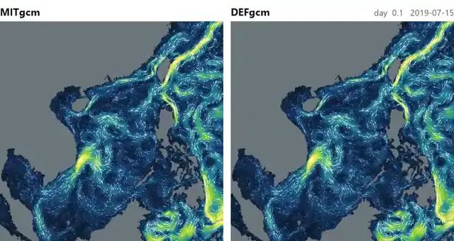

<a href="https://wojiaonioo.github.io">Homepage</a>&nbsp;&nbsp;|&nbsp;&nbsp;<a href="https://wojiaonioo.github.io/assets/tanghaoyang-cv-en.pdf">CV (PDF)</a>&nbsp;&nbsp;|&nbsp;&nbsp;<a href="mailto:tanghy@idsse.ac.cn">tanghy@idsse.ac.cn</a>

### DEFgcm

I implemented the ocean discretizations of MITgcm in PyTorch so that one program computes integrations and their gradients on GPUs. Over the South China Sea, its integrations differ from those of MITgcm about as much as MITgcm runs with reordered sums do. [Code](https://github.com/wojiaonioo/DEFgcm)&nbsp;&nbsp;|&nbsp;&nbsp;[Preprint (Chinese, PDF)](https://wojiaonioo.github.io/assets/defgcm-preprint-cn.pdf?v=20261106d)

29 days of surface currents, South China Sea and western Pacific at 1/32°. MITgcm left, DEFgcm right; the two differ by about as much as two MITgcm runs that differ only in the order of their global sums.

On a 960×960×90 grid, four A800 GPUs run a hydrostatic step 1.6 times as fast as MITgcm on 768 CPU cores. In South China Sea twin experiments, 4D-Var with these gradients lowers the forecast error three days after the window by 40% on average. On 13 test windows after the training period, a network trained online through the model recovers 81% of the 4D-Var improvement from one gradient evaluation. At the same mean forecast error three days after the window, the network produces an analysis 11.4 times as fast as 4D-Var on one A800. Details on the [homepage](https://wojiaonioo.github.io/?lang=en#hybrid).
