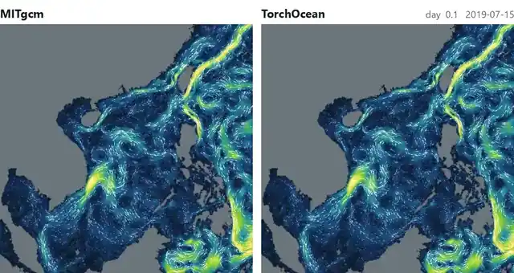

<a href="https://wojiaonioo.github.io">Homepage</a>&nbsp;&nbsp;|&nbsp;&nbsp;<a href="https://wojiaonioo.github.io/assets/tanghaoyang-cv-en.pdf">CV (PDF)</a>&nbsp;&nbsp;|&nbsp;&nbsp;<a href="mailto:tanghy@idsse.ac.cn">tanghy@idsse.ac.cn</a>

### TorchOcean

An ocean general circulation model I rewrote from MITgcm in PyTorch and CUDA. Gradients pass through the whole integration, so a neural network can sit inside the time step and be trained online.

29 days of surface currents, South China Sea and western Pacific at 1/32°. MITgcm left, TorchOcean right; their rms difference stays below 1.3×10⁻⁴ m/s.

Aligning TorchOcean with MITgcm turned up two defects in MITgcm itself, reported upstream: [#989](https://github.com/MITgcm/MITgcm/issues/989), fixed by [#990](https://github.com/MITgcm/MITgcm/pull/990) (merged); [#1039](https://github.com/MITgcm/MITgcm/issues/1039), my fix [#1040](https://github.com/MITgcm/MITgcm/pull/1040) approved and awaiting merge.
